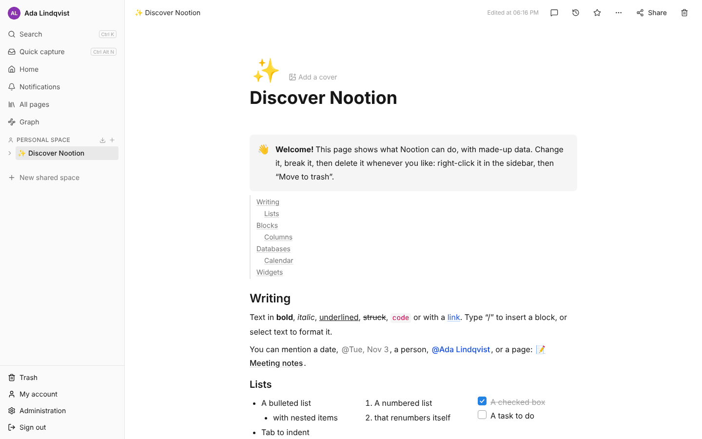
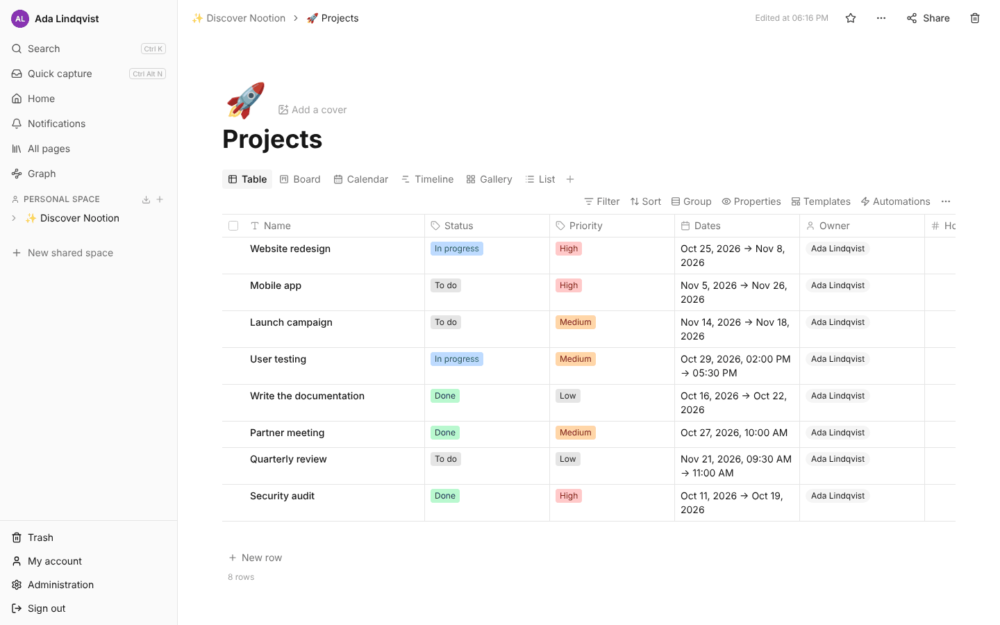
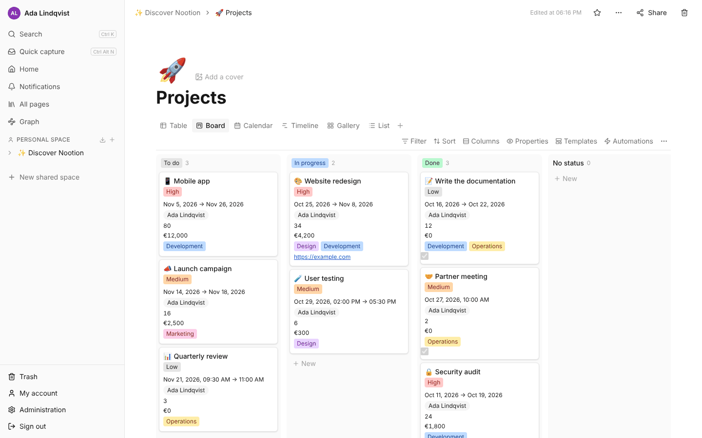
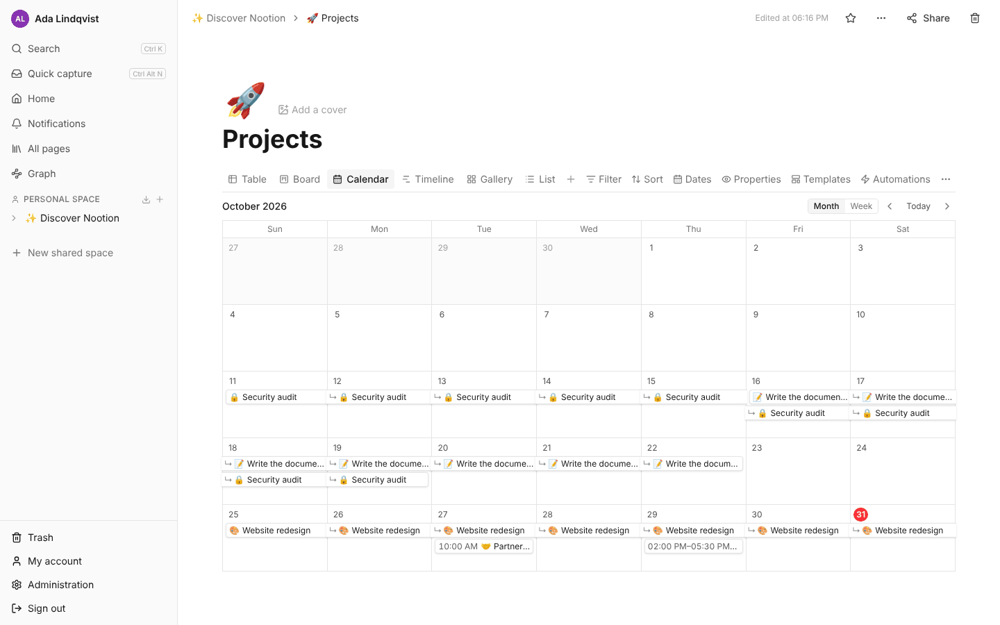
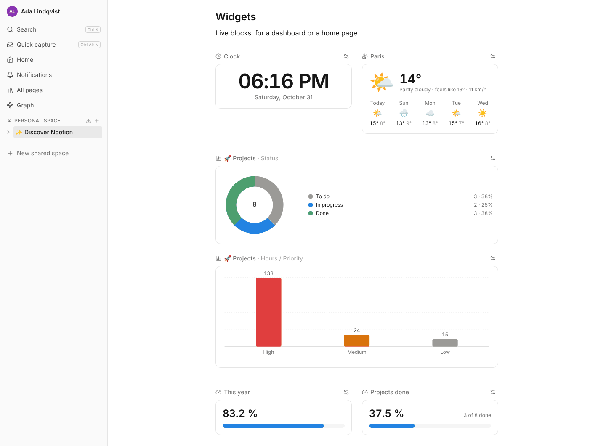
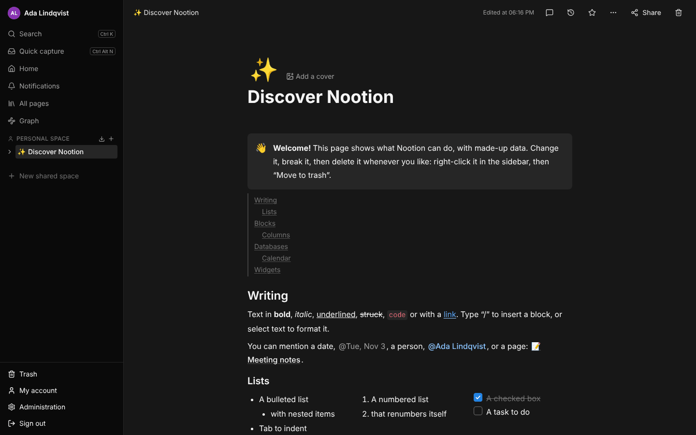

# Nootion

**An open-source, self-hosted alternative to Notion, Capacities and Docmost**: pages, wikis and real databases,
on your own server, in a single Docker container.

> Version 3.4.0. See [CHANGELOG.md](CHANGELOG.md) for what changed and [PLAN.md](PLAN.md) for what comes next.



## Why Nootion

Notion and Capacities are closed cloud services: your notes live on their servers, under their terms and prices.
Docmost is open source and self-hosted, but is built for wikis and documentation. Nootion brings the two together:
the freedom of an open-source app you host yourself, and the databases that make Notion so useful.

- **Your data stays at home.** One container and one data folder (a SQLite file and your attached files):
  backing up Nootion is copying a folder. No telemetry, no external service needed.
- **Real databases.** Typed columns, relations in both directions, rollups, Notion-like formulas, filters, sorts,
  groups and calculations, table, board, list, gallery, calendar and timeline views, embedded in any page. Enough to run invoices, projects,
  a reading list or a CRM.
- **Leave Notion without losing anything.** The Notion import brings pages, databases, relations, rollups,
  formulas, files and links between pages, and can run again to fetch what changed.
- **Write together.** Real-time collaborative editing, comments and @mentions, shared spaces with roles, page
  sharing and read-only public links, with every access checked on the server.
- **Let it run by itself.** Database automations, recurring templates, buttons, and automatic backups to a NAS or
  Nextcloud.
- **On the phone, even offline.** Installs as an app on phones and computers; pages already opened stay readable
  and editable offline and sync when the connection comes back, merged with others' changes.
- **Yours to extend.** Plugins add editor blocks, database column types, API routes, scheduled tasks and formula
  functions.
- **Open for good.** Licensed under the AGPL-3.0: the code, and the code of any hosted version of it, stays open.
- **Light.** Runs on a small home server or NAS (amd64 and arm64), no separate database server or Redis.

The interface is available in English and French; each user picks their language.

## Screenshots

| | |
| --- | --- |
|  |  |
| **Databases**: one database, many views (table, board, calendar, timeline, gallery, list). | **Board** view, grouped by any select column. |
|  |  |
| **Calendar** with date ranges and times. | **Widgets** for dashboards: charts, progress, weather, clock and more. |
|  | |
| **Dark mode**, following the system or picked by hand. | |

These come from "Discover Nootion", the demo page every new user gets.

## Getting started

```bash
mkdir nootion && cd nootion
curl -O https://raw.githubusercontent.com/btronquo/Nootion/main/docker-compose.yml
curl -o .env https://raw.githubusercontent.com/btronquo/Nootion/main/.env.example
# Set APP_SECRET (openssl rand -hex 32) and APP_URL in .env, then:
docker compose up -d
```

Then open `APP_URL` and create the administrator account. The image, `ghcr.io/btronquo/nootion`, runs on amd64 and arm64.
[docs/DEPLOYMENT.md](docs/DEPLOYMENT.md) covers `docker run`, updates, backups, HTTPS, installing the app on a phone,
offline use and the Notion import.

## All features

### Accounts and spaces

- First launch: creation of the administrator account.
- Sign in / sign out, secure sessions (httpOnly cookie, argon2 password hashes).
- Two-factor authentication with an authenticator app (6-digit codes), with recovery codes; administrators can
  turn it off for someone who lost their phone.
- Invitations by link (valid 7 days, optionally restricted to one email), admin / member roles, account disabling.
- A private personal space for each user, and shared spaces with roles (owner, editor, commenter, viewer).
- Single sign-on with Microsoft Entra ID, Google, Okta, Keycloak or any OpenID Connect provider, and SCIM so that
  people who leave the company are disabled automatically. See [docs/SSO.md](docs/SSO.md).
- "My account" page: name, email, password, profile picture, language, light / dark / system theme, imports, emptying a space and deleting the account with its data.
- English and French interface, chosen per user.

### Pages and editor

- Page tree (subpages, drag and drop, icons), cover images, trash with restore, favorites at the top of the sidebar.
- Pages are private by default: share a page with a user (inherited by subpages), or through a revocable read-only public link.
  Every access check is done on the server (`apps/server/src/permissions.ts`) and covered by tests.
- Notion-like page editor ("/" commands, to-do lists, tables, callouts, toggles, columns, images and attached files,
  links between pages with "@", people mentions, table of contents), with real-time collaborative editing.
- Repeating to-dos: checked, their date moves on to the next day, week, month or chosen days, reminder included.
- Images open full screen when clicked, to go through a page's images.
- Videos (`/video`): YouTube, Vimeo, Dailymotion, Loom, PeerTube, Twitch or Google Drive links, or video files.
- Drawing block (`/drawing`): pen, highlighter, shapes, arrows and text boxes, saved with the page, with a
  full-screen whiteboard and an SVG download.
- Comments on a passage or on the whole page: threads with replies, resolved and reopened, that follow their
  passage as the page is edited. "@" mentions someone, in a comment or in the page, and notifies them.
- Quick capture (Ctrl+Alt+N or ⌘⌥N, or shared from another app to the installed app): a note dropped in your inbox,
  to file later.
- Page history: versions kept automatically with their authors, changes highlighted, any version restored.
- Backlinks: each page lists the pages that mention it.
- Page graph: the pages of your spaces and the links between them, as a map to explore.
- "Full width" option per page.

### Databases

- Databases: typed columns (text, number, currency amount, percent, date, select, multi-select, checkbox, link,
  email, person, files, created time, last edited time, created by), table view (column order, width and visibility),
  each row opens as a page with its properties. Rows have Notion's menu (right click or ⋮⋮: favorite, icon, open,
  copy link, duplicate, trash), a "+" to add one just below, and can be dragged to reorder them. A database can be
  a page of its own or embedded in a page
  (`/database` command), and shows read-only on public links.
- Calculations under columns (sum, average, median, min, max, count, percent checked, dates…).
- Relations between databases (one way or both ways, kept up to date automatically) and rollups
  (e.g. the total of a supplier's invoices).
- Notion-like formulas: `prop("Price") * 1.2`, `if(prop("Paid"), "OK", "To pay")`, `dateBetween(now(), prop("Due"), "days")`…
  Editor with live checking and function help; formulas work with relations, rollups and calculations. Notion 2's
  syntax works too: lists `[1, 2]`, methods `prop("Name").upper()`, `let`/`lets`, and `map`, `filter`, `find`,
  `some`, `every`, `sort` with `current`, including the columns of related pages:
  `prop("Invoices").filter(current.prop("Paid")).map(current.prop("Total")).sum()`.
- Several views per database (table, board, list, gallery, calendar or timeline), each with its own filters
  (and / or, relative dates such as "the next week"), sorts, groups and visible columns. Drag and drop between board
  columns, between calendar days to change a date, and along the timeline to move or stretch a date range.
- A `/calendar` block for any page: the dated rows of several databases on one calendar, each in its colour,
  with a private iCal link to follow them in a phone or desktop calendar (Google, Apple, Outlook, Thunderbird).
- Templates: row templates (content and default values, one used for every new row if chosen) and page templates
  offered on any empty page, copied with their subpages, databases and files. A template can repeat: a new page or
  row every N days, on some days of the week or on a day of the month.

### Home page and widgets

- A personal home page with widgets: recently visited pages, favorites, upcoming events, the first rows of a
  database view (e.g. the open to-dos), arranged by each user.
- Widgets for any page, from the "/" menu: charts of a database (bars, columns, line, donut), progress bars (of the
  year, of a goal, of the rows checked), countdown, Pomodoro timer, habit tracker, clock, weather, quote of the day and
  image carousel.

### Automation

- Database automations: when a row is added, a column changes or a date arrives, run steps on the row (e.g. "Status
  set to Paid → fill in the payment date"), or on a schedule (every day, week or month), with the last runs and
  their errors listed. Steps can hold formulas (`{{= dateAdd(prop("Due"), 1, "weeks")}}`).
- Buttons with automations and forms: add a row, change the current row, create a page from a template, open a
  link, call a webhook, after an optional form that can also be opened by a public link. See [docs/BUTTONS.md](docs/BUTTONS.md).
- Dates written in plain words (`@tomorrow 9am`, `@vendredi`, `@in 3 days`) with reminders, sent as notifications
  to the phone or computer, and by e-mail.
- E-mail through any SMTP server or Resend, set in Administration: reminders, mentions, replies, invitations and
  "Forgot password"; each user picks the e-mails they get.

### Search

- Full-text search in page titles and content (Ctrl+K or ⌘K), accent-insensitive, limited to the pages the user can read.
- Search inside attached files: PDFs, images and scans (OCR), text files.

### Integrations and extensions

- REST API with personal tokens (per space, read-only or read and write): pages as Markdown, database queries,
  rows, files, search. See [docs/API.md](docs/API.md).
- Built-in MCP server: connect Claude (as a custom connector) or another AI agent to search, read and write your
  pages and databases, within the spaces you choose, with every change it makes logged. See [docs/MCP.md](docs/MCP.md).
- Plugins: editor blocks, database column types, API routes, scheduled tasks and formula functions, turned on and
  set up in the administration. See [docs/PLUGINS.md](docs/PLUGINS.md) to write your own. Nootion ships with:
  - "Embeds" (`/embed`: YouTube, Vimeo, Spotify, Google Maps, Figma, link previews);
  - "Nextcloud": each person connects their account, then copies files into pages and "File" columns, or links to
    them ([docs/NEXTCLOUD.md](docs/NEXTCLOUD.md));
  - "Google Calendar": syncs a database with a Google calendar, both ways, with the administrator's OAuth client or
    each person's own ([docs/GOOGLE_CALENDAR.md](docs/GOOGLE_CALENDAR.md));
  - "Ratings": a column of one to five stars;
  - "Test management (QA)": test cases, runs and results as in TestRail, over several products at once
    ([docs/QA.md](docs/QA.md));
  - "Map": the rows of a database as pins on a map, places added by address or with a click, the nearest ones to
    you ([docs/MAP.md](docs/MAP.md)).

### Import, export and backups

- Import from Notion through its API: pages, databases with their columns, relations, rollups and formulas, files
  and links between pages, with a report of what was imported differently. See [docs/DEPLOYMENT.md](docs/DEPLOYMENT.md#importing-from-notion).
- Export a page or a space as Markdown (.zip: subpages, attached files, databases as CSV and JSON),
  export a database as CSV (or CSV for Excel) and JSON with computed formulas, import a CSV into a database
  (columns and options created as needed), full backup downloadable by the admin, and automatic backups every
  day or week to a folder of the server or a WebDAV folder (Nextcloud), keeping the last copies.
  See [docs/DEPLOYMENT.md](docs/DEPLOYMENT.md).

### Phone and offline

- Works on phones and installs as an app (PWA, over HTTPS): sidebar as a drawer, editing toolbar above the keyboard,
  database rows as cards. See [docs/DEPLOYMENT.md](docs/DEPLOYMENT.md#installing-the-app-on-a-phone-or-computer).
- Works offline: pages already opened stay readable and editable, and changes sync when the connection comes back
  (page content is merged with others' changes, database cells are sent in order).

### Desktop app

- For Windows, macOS and Linux: connect to one or more Nootion servers, or keep a space on the computer with no
  server at all. Spaces of a server can be synced to the computer, to work on them without a connection; changes
  from both sides are merged. See [docs/DESKTOP.md](docs/DESKTOP.md).

### Hosting

- Single Docker image (amd64 and arm64), data in `/data`.
- Hardened by default: security headers and a content security policy, sign-in attempts limited, requests to
  addresses people type (webhooks, link previews) kept away from the server's own network, and a people directory
  limited to those one works with. See [docs/DEPLOYMENT.md](docs/DEPLOYMENT.md#securing-your-instance).
- "What's new" window after an update: the release notes of the versions each person hasn't seen yet.

## Development

Requirements: Node.js 22 and pnpm 10 (`corepack enable`).

```bash
pnpm install
pnpm dev          # server on :3000, interface on http://localhost:5173
pnpm test         # automated tests
pnpm typecheck
pnpm lint         # mistakes the compiler doesn't see (ESLint)
pnpm format       # formatting (Prettier, 160 columns)
pnpm build
```

After changing `apps/server/src/db/schema.ts`, run `pnpm --filter @nootion/server db:generate` to create the migration.
Migrations are applied automatically at startup.

Interface texts live in `packages/shared/src/i18n/` (`en.ts` is the reference, `fr.ts` the French translation);
see [CONTRIBUTING.md](CONTRIBUTING.md#translations) to add a language.

To find your way in the code: [docs/ARCHITECTURE.md](docs/ARCHITECTURE.md).

## Project layout

```
apps/server      Fastify API + Drizzle + SQLite
apps/web         React + Vite + Tailwind interface
apps/desktop     Desktop app for Windows, macOS and Linux (Tauri), see docs/DESKTOP.md
packages/shared  Types, validation, formulas, views and translations shared by both
docker/          Dockerfile
docs/            Documentation (deployment, architecture, API, SSO, plugins…)
```

## Contributing

Bug reports and ideas are welcome in the issues. Nootion doesn't accept code contributions (pull requests):
see [CONTRIBUTING.md](CONTRIBUTING.md).
For a security issue: [SECURITY.md](SECURITY.md).

## License

[AGPL-3.0](LICENSE)
