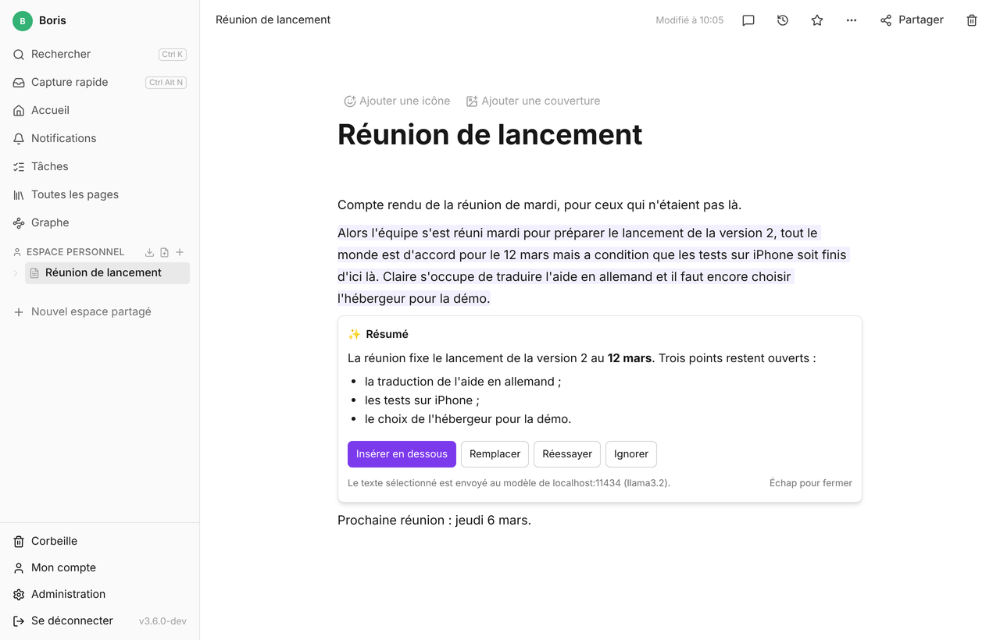

# AI assistant

The **AI assistant** plugin adds an "AI" menu to the bar shown over selected text: **Summarise**, **Translate to…**,
**Improve the writing**, **Continue** and **Ask…**. The answer is written in a panel right under the passage, as it
comes, and is put in the page only with a click.

It is off by default and works with the administrator's own key (Anthropic, OpenAI, Mistral) or with a model running
on your own network (Ollama, or a server compatible with OpenAI's API such as LM Studio or vLLM).

## Turning it on

In **Administration › Plugins › AI assistant**:

| Setting | |
|---|---|
| Service | Anthropic (Claude), OpenAI or a compatible server, Mistral AI, or Ollama. |
| API key | The service's key, kept encrypted on the server (with `APP_SECRET`) and never shown again. Not needed for Ollama. |
| Model | Empty for the default: `claude-opus-5-5` (Anthropic), `gpt-5-mini` (OpenAI), `mistral-small-latest` (Mistral), `llama3.2` (Ollama). Any model of the service can be typed. |
| Address of the model | Ollama: its address, `http://localhost:11434` when empty (in Docker, the address of the machine running Ollama, e.g. `http://192.168.1.20:11434` or `http://host.docker.internal:11434`). OpenAI: the address of a compatible server (`http://192.168.1.20:1234/v1`), empty for OpenAI itself. |
| Requests per person per day | 0 for no limit. The count starts again at midnight, server time, and survives a restart. |
| Guests may use it too | Off by default: only members, not people invited from outside on a page. |

Changing a setting takes effect at once; pages already open pick up the menu's new note when reloaded.

## Using it

Select some text in a page you may edit, then open **✨ AI** in the bar over the selection (on a phone, the ✨ button
of the bar above the keyboard):

- **Summarise**: a few sentences, or a short list, in the language of the passage.
- **Translate to…**: asks for the language (the last one is remembered), keeps the formatting.
- **Improve the writing**: spelling, grammar and clearer sentences, same meaning and tone.
- **Continue**: one or two paragraphs that follow the passage.
- **Ask…**: a question about the passage ("Which dates are mentioned?").

While the answer is written, **Stop** ends it. Then, depending on the action:

- **Replace** puts the answer in place of the passage (the main button for translations and improved writing);
- **Insert below** adds it under the passage (the main button for summaries and answers);
- **Insert** adds a continuation right after the passage;
- **Try again** asks again, **Discard** (or Escape) closes the panel and leaves the page as it was.

Lists, headings, bold and links of the answer become real blocks of the page. Ctrl+Z takes back an insertion. Other
people editing the page at the same time see nothing until the answer is accepted.

## What is sent, and where

- Nothing leaves the server without a click on an entry of the menu (and, for a translation or a question, on
  "Translate" or "Send").
- Only the selected passage is sent (30,000 characters at most), with the instruction of the entry chosen: not the
  rest of the page, its title or who wrote it.
- The menu and the panel say where the text goes: "The selected text is sent to Anthropic (claude-opus-5-5)", or
  "to the model at nas.local:11434" for a local one.
- Requests go from the server, not from the browser: the key never reaches the browser. The server reaches the
  service's own address only; the address of the model is the one address allowed on your local network.
- With Anthropic, `claude-opus-5-5` and other recent models answer at a low effort (short writing tasks), and when a
  model declines a request, the service may hand it to another model instead of stopping (the panel says when the
  request was declined).
- Usage is counted per person and per day, never the texts. The service's own rules about the data it receives
  apply (see its terms).

For an outside assistant that reads and writes pages by itself, see the MCP server: [MCP.md](MCP.md).

## For developers

The plugin is built on two hooks that any plugin can use: entries in the menu of a selection, with a panel under the
passage (`registerSelectionMenu`), and routes that send their answer as it is written (`nootion.stream`, read with
`nootion.fetch`). See [PLUGINS.md](PLUGINS.md#entries-in-the-menu-of-a-selection).
