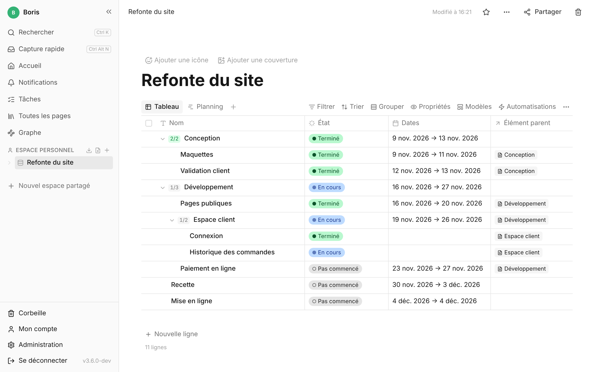
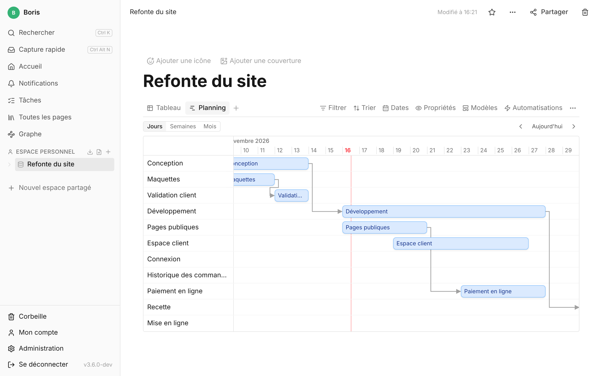

# Databases: sub-items and dependencies

Two options of a database organise its rows among themselves. Both are in the **⋯** menu of the database's toolbar,
under "Organise rows", for people who can edit the database. Each adds two columns that link the rows of the
database to each other; turning the option off deletes those two columns (the rows stay).

## Sub-items

"Sub-items" adds a **Parent item** column and its twin, **Sub-items**. A row with a parent shows under it in tables,
indented, and a parent has an arrow to fold or unfold its sub-items (remembered in your browser) and the share of
them that is done, such as `1/3`. A row counts as done when its first status column is in the "Done" category, or,
without a status column, when its first checkbox is checked.

- To make a row a sub-item, pick its parent in the "Parent item" cell, or add rows to a parent's "Sub-items" cell.
  "Add a sub-item" in the row menu (right click or ⋮⋮) and on the row's page creates one directly.
- A row has one parent at most: given as the sub-item of another row, it leaves its previous parent. A row can't be
  placed inside its own sub-items.
- With filters, a matching sub-item keeps its parents visible, greyed out, so you see where it belongs. Sorts apply
  among the sub-items of each parent.
- A row opened as a page lists its sub-items with a progress bar, and a button to add one.
- Grouped tables, boards, lists, galleries and calendars show the rows flat. The two columns are ordinary
  relations: filters, rollups (for instance the share of sub-items done), formulas, exports and the API use them as
  any other relation.

## Dependencies

"Dependencies" adds a **Blocked by** column and its twin, **Blocking**. On a timeline, an arrow goes from the end of
each row's bar to the start of every row waiting on it; it turns red when a row starts before the row it waits on
ends. A row opened as a page says which rows it is still waiting on (those not done yet).

- Dependencies can't go round in a loop: a row can't end up waiting for itself, directly or through other rows.
- **When a row's dates move, move the rows it blocks too**: with this box ticked (under the option), moving the end
  of a row's date by some days moves the rows it blocks by as many days, then the rows they block, and so on, so the
  gaps between them stay. Changing only the start of a row moves nothing else. Times of day are kept.
