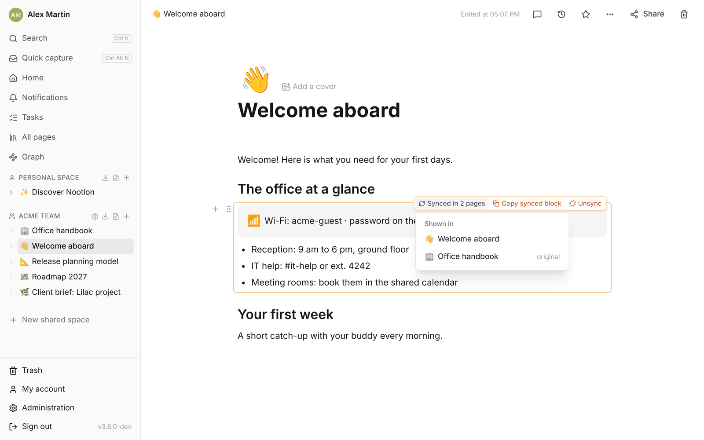
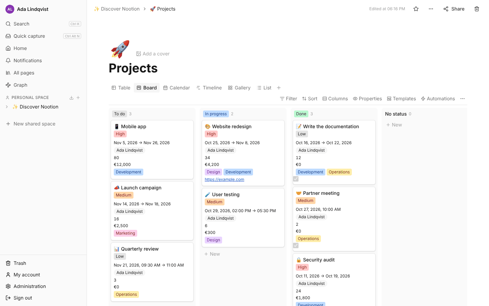
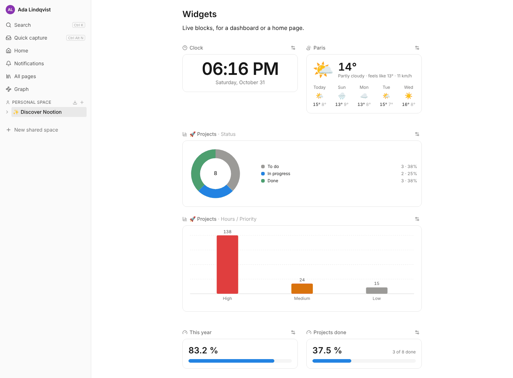
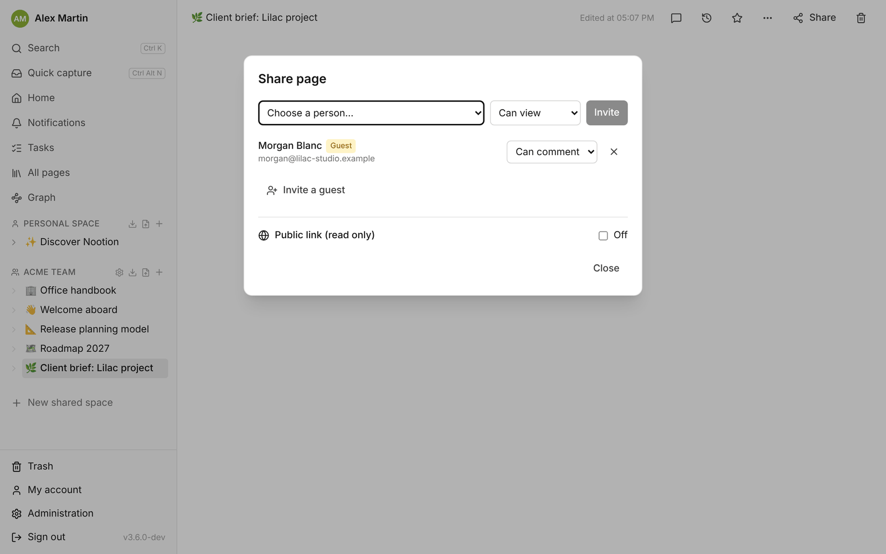
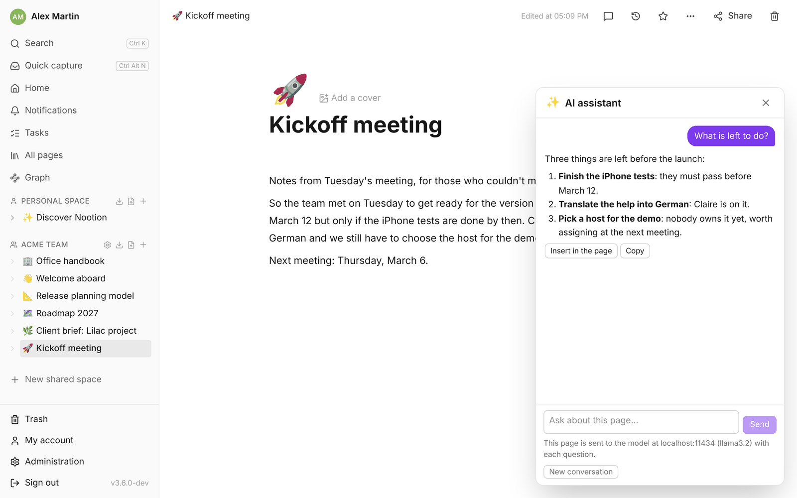

# Features

Everything Nootion does today, by theme. Each guide of the documentation goes into the details.

## Pages and editor

- **Block editor** with "/" commands: to-do lists, tables, callouts, toggles, columns, images and files, videos,
  links between pages with "@", people mentions and a table of contents.
- **Real-time collaboration**: several people edit the same page at once; comments on a passage or on the whole page,
  with replies, and @mentions that notify.
- **Synced blocks**: the same content in several pages, edited from any of them.
- **Equations** in LaTeX, in a line or as a block, and **Mermaid diagrams** drawn as you type.
- **Code blocks** coloured for about 35 languages, a **drawing block** with a full-screen whiteboard.
- **Page history** with authors and highlighted changes, backlinks, a graph of the links between pages.
- **Tabs** to keep several pages open, **quick capture** (Ctrl+Alt+N) to drop a note in your inbox.
- **Lock** a page against accidental edits, **print** or save it as PDF.

See [Writing and finding](../../docs/EDITOR.md).

## Databases

- **Typed columns**: text, number, currency, percent and progress bars, dates, select, status, checkbox, link, e-mail,
  phone, person, files, numbered IDs, created and edited times and authors.
- **Six views**, each with its own filters, sorts and groups: table, board, list, gallery, calendar and timeline.
- **Relations** both ways, **rollups** and **formulas**, with an editor that checks them as you type.
- **Sub-items and dependencies**, drawn as arrows on the timeline.
- **Linked views** of a database in any page, **calculations** under columns, **templates** that can repeat.
- A **calendar block** gathering several databases, with a private iCal link for your phone.

See [Databases](../../docs/DATABASES.md).

## Home page, widgets and automations

- A personal **home page** with recent pages, to-dos, favorites, upcoming events and database views.
- **Widgets** in any page: charts, progress bars, countdown, Pomodoro timer, habit tracker, clock and weather.
- **Automations**: when a row is added, a column changes or a date arrives, or on a schedule.
- **Buttons and forms** that add rows, fill in values, create pages from templates or call a webhook.
- **Dates in plain words** (`@tomorrow 9am`) with reminders, by notification and by e-mail.
- **Tasks**: every to-do of every page in one list, by page or by date.

See [Buttons and automations](../../docs/BUTTONS.md).

## Search

- Full-text search in titles and content (Ctrl+K), accent-insensitive, limited to what each person can read.
- Search inside attached files: PDFs, images and scans (OCR), text files.
- Search inside database values, with filters and saved searches.
- A **command palette** in the same box: type ">" for actions only.

## Sharing and security

- A private **personal space** for each user, and **shared spaces** with roles: owner, editor, commenter, viewer.
- **Groups** of people, **guests** from outside invited on one page, **public links** with an optional password and
  end date. Every access is checked on the server.
- **Two-factor authentication**, **passkeys**, **single sign-on** with Microsoft Entra ID, Google, Okta, Keycloak or
  any OpenID Connect provider, and **SCIM**.
- An **activity log** for administrators, with filters and a CSV export.
- Hardened by default: security headers, a content security policy, limited sign-in attempts.

See [Single sign-on](../../docs/SSO.md) and [Securing your instance](../../docs/DEPLOYMENT.md#securing-your-instance).

## Import, export and backups

- **Import from other tools** through their API, or from Markdown, HTML, Word, text and CSV files: pages,
  databases, relations, rollups, formulas, files and links between pages come along.
- **Export** a page or a space as Markdown, a database as CSV or JSON.
- **Automatic backups** every day or week, to a folder of the server or a WebDAV share such as Nextcloud.

## Phone, desktop and offline

- Works on phones and **installs as an app**, with a toolbar above the keyboard and database rows as cards.
- **Works offline**: pages already opened stay readable and editable, and changes sync when the connection comes back.
- **Desktop app** for Windows, macOS and Linux. See [Install the desktop app](install-desktop.md).

## Extend it

- **Plugins**: editor blocks, column types, API routes, scheduled tasks and formula functions. Nootion ships with
  Embeds, Nextcloud, Google Calendar, Ratings, Test management, Map and an AI assistant.
- **AI assistant** (off by default): summarise, translate, improve or ask about a selection, with your own key or a
  model on your network. Nothing is sent without a click.
- **REST API** with personal tokens, and a built-in **MCP server** for AI agents.

See [Writing plugins](../../docs/PLUGINS.md), [AI assistant](../../docs/AI_ASSISTANT.md), [REST API](../../docs/API.md)
and [MCP server](../../docs/MCP.md).

## For administrators

- One container, amd64 and arm64, data in one folder; attached files can go to **S3-compatible storage**.
- A **setup assistant** after the first launch, a **guided tour** for each new account.
- Your **own name and logo** for the instance.
- The interface in **English, French, German, Spanish and Italian**, chosen by each user.
- A "What's new" window after each update.
