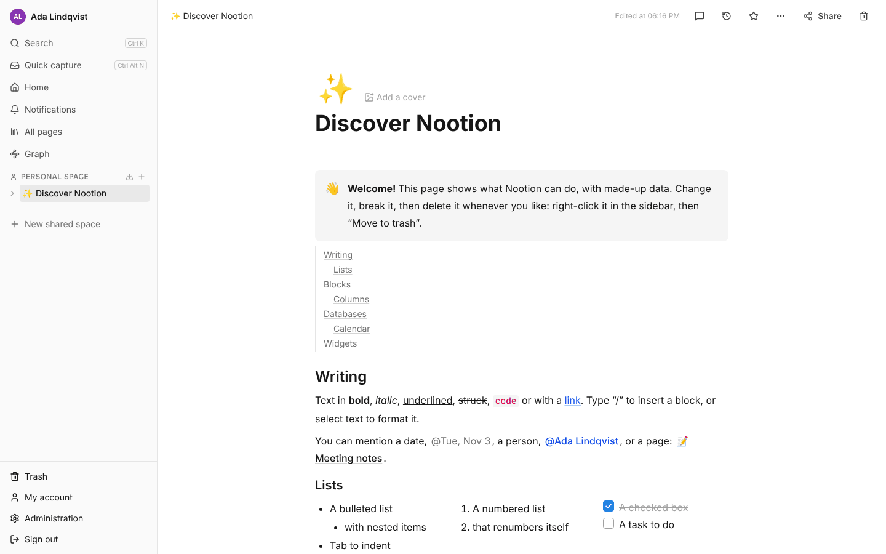

# Getting started

Nootion is an open-source workspace: pages and wikis, real databases, comments and real-time collaboration. You
don't need a server to use it: the desktop app keeps everything on your computer. To work with others, host it in a
single Docker container; your data stays on your server, in one folder.



## Three ways to use Nootion

| | For | How |
| --- | --- | --- |
| **Desktop app** | Yourself, on Windows, macOS or Linux, with nothing to set up | Keeps a space on the computer with no server and no account, and can connect to servers later. See [Install the desktop app](install-desktop.md). |
| **On a server** | A team, a family, or yourself from any device | One Docker container on a server, a NAS or a small home server. See [Install with Docker](docker.md). |
| **On a phone** | Android, iPhone and iPad | Open your server in the browser and install it as an app. See [Installing the app on a phone](../../docs/DEPLOYMENT.md#installing-the-app-on-a-phone-or-computer). |

## Quick start with the desktop app

Download the installer for your system from the [latest release](https://github.com/btronquo/Nootion/releases/latest),
install it, then choose **On this computer** in the first window. That's all: no server, no account.

## Quick start with Docker

You need a machine with Docker and Docker Compose (amd64 or arm64).

```bash
mkdir nootion && cd nootion
curl -O https://raw.githubusercontent.com/btronquo/Nootion/main/docker-compose.yml
curl -o .env https://raw.githubusercontent.com/btronquo/Nootion/main/.env.example
# Set APP_SECRET (openssl rand -hex 32) and APP_URL in .env, then:
docker compose up -d
```

Open the address you put in `APP_URL` (for example `http://localhost:3000`).

## Your first ten minutes on a server

1. **Create the administrator account.** The first page asks for a name, an e-mail, a password and a language.
2. **Follow the setup assistant.** It goes through e-mail, sign-in and security, backups, the AI assistant, plugins
   and the team, one step at a time. Every step can be skipped and found again in Administration.
3. **Invite your team.** Administration › Invitations creates links, valid for seven days.
4. **Bring your notes.** My account › Import takes Markdown, HTML, Word and CSV files, or a zip of them, and can
   import from other tools through their API. See [Importing from files](../../docs/DEPLOYMENT.md#importing-from-files).
5. **Take the tour.** Each new account gets a short guided tour of the features. My account opens it again.

Each new user also finds a demo page, "Discover Nootion", with made-up data to try everything. Delete it whenever
you like.

## Where to go next

- [Features](features.md): everything Nootion does, with screenshots.
- [Deployment reference](../../docs/DEPLOYMENT.md): variables, updates, HTTPS, security, S3 storage, e-mail and backups.
- [Writing and finding](../../docs/EDITOR.md): the editor, search, the command palette and sharing.
- [Databases](../../docs/DATABASES.md) and [Buttons and automations](../../docs/BUTTONS.md).
- [REST API](../../docs/API.md), [MCP server](../../docs/MCP.md) and [Plugins](../../docs/PLUGINS.md) to go further.

Found a bug or have an idea? Open an [issue on GitHub](https://github.com/btronquo/Nootion/issues).
